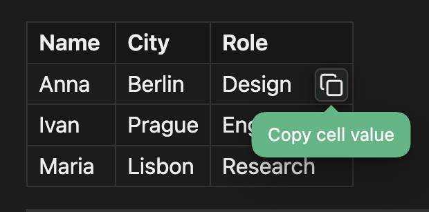

# Copycel

Copycel copies a table cell with one click. In Reading view and Live Preview, hover a cell to show a copy icon, then click the icon to copy the cell value.

## Installation

Install Copycel from **Settings → Community plugins → Browse**.

## Clipboard

When you click the copy icon, Copycel writes that cell's text to the system clipboard. It does not read the clipboard, so text copied from other applications stays there until you copy a cell. The cell value can appear in the operating system's clipboard history.

## Usage

1. Open a note that contains a Markdown table.
2. Hover a cell in Reading view or Live Preview. A copy icon appears in the corner of the cell.

   

3. Click the icon. The cell value is copied to the clipboard, and the cell flashes briefly.

## Settings

- **Show notification** — show a notice after a cell value is copied. Defaults to on.
